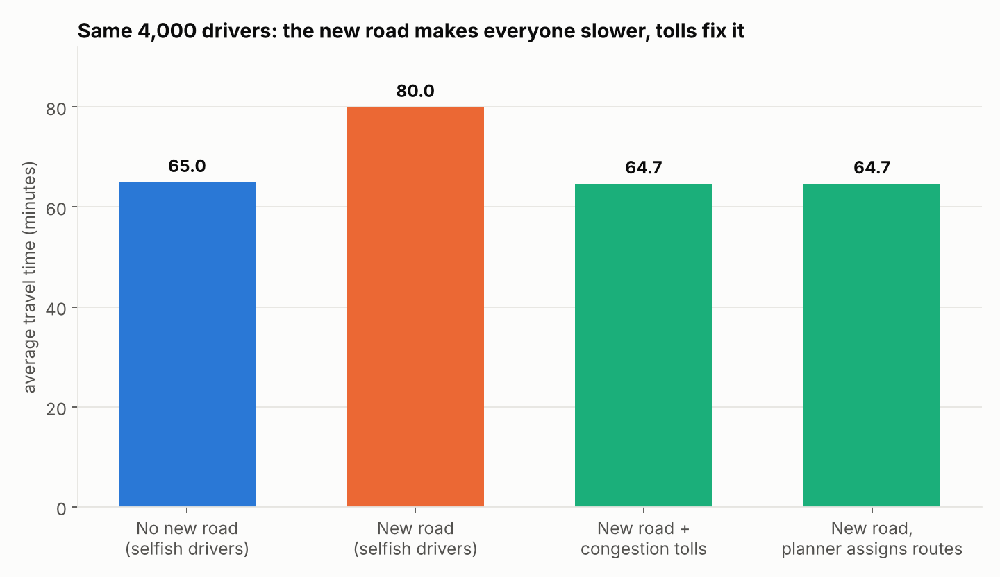
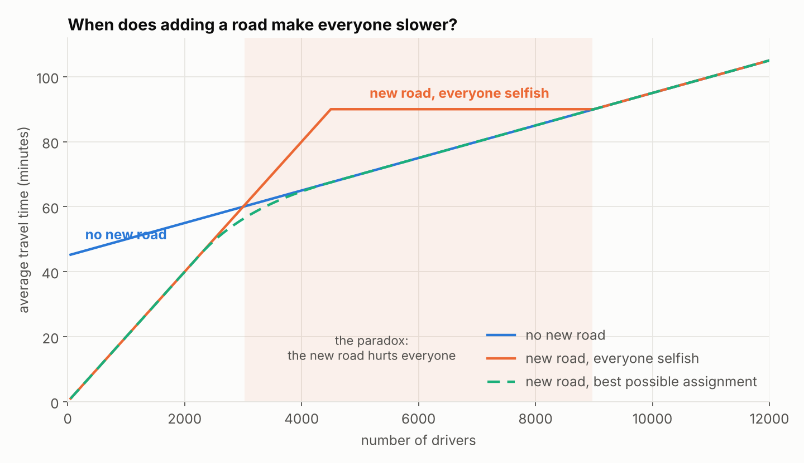
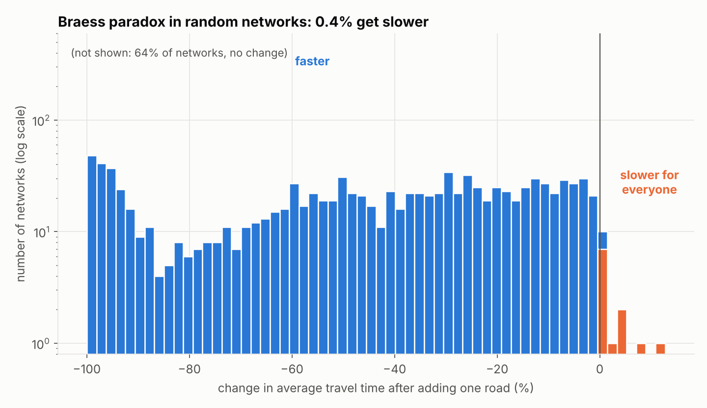
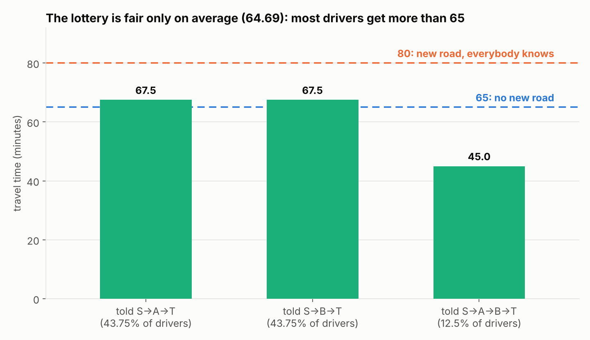
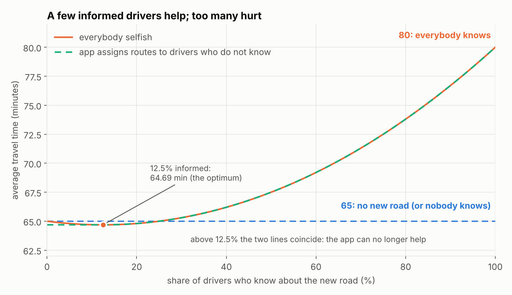

# Traffic Paradox Lab

**When does adding a road make every driver slower, and how can it be fixed?**

A simulator of *selfish routing*: every driver picks the route that is fastest for
them. The project computes what drivers actually do (equilibrium), what would be best
for everybody (optimum), how much selfishness costs (Price of Anarchy), and compares two
ways to fix it: **congestion tolls** and **information design** (randomized route
recommendations for drivers who do not know about the new road).



## The paradox in one example

4,000 drivers travel from S to T. Two roads are narrow (time = *drivers ÷ 100* minutes),
two are long highways (always 45 minutes).

| | Average travel time |
|---|---|
| No new road: 2,000 drivers on each route | **65 min** |
| Add a free shortcut A→B: everyone takes S→A→B→T | **80 min** |
| Best possible assignment (500 drivers on the shortcut) | **64.7 min** |

After the shortcut opens, no driver can gain by switching alone (the alternatives take
85 min), so 80 minutes is a Nash equilibrium. Every driver is 15 minutes slower, yet
nobody did anything irrational. This is **Braess's paradox** (1968).

## What the project does

- Models a road network where each road has time `a·x + b` (`x` = drivers on it).
- Finds the **Wardrop equilibrium** (selfish drivers) and the **social optimum** with a
  pairwise Frank-Wolfe solver written from scratch (NumPy only). The solver supports
  several classes of drivers that may use different roads.
- Computes the **Price of Anarchy** = equilibrium total time ÷ optimum total time.
- Computes **marginal-cost (Pigouvian) tolls** and verifies that, with them, selfish
  drivers reach the optimum.
- Sweeps the number of drivers to find where the paradox appears.
- Searches random networks to see how common the paradox is.
- **Information design:** turns the optimal flow into a lottery of route recommendations,
  checks whether drivers would obey, and studies what happens when only some drivers know
  about the new road.

## Results

**1. The paradox only appears for a range of traffic levels.**
On the classic network, the new road makes everyone slower for roughly **3,000 to 9,000
drivers**. With less traffic it helps; above 9,000 drivers nobody uses it.



**2. Tolls fix it.** Charging each driver the extra delay they cause (22.5 minutes-equivalent
on each narrow road in the example) moves the equilibrium to exactly the optimum: 64.7 min.

**3. In random networks the paradox is real but rare.**
3,000 random 6-node networks, one random cheap road added to each
(`python -m experiments.random_search`, seed 0):

| Outcome | Share of networks |
|---|---|
| Every driver faster | 35.6 % |
| No change | 64.0 % |
| Every driver slower (paradox) | 0.4 % |

Worst slowdown found: +12.7 %. Trying every missing road of a network in turn (as a road
with a fixed time of 0.1), 1.6 % of the networks contain at least one road that slows every
driver. These percentages depend on how the random networks are generated (see the script),
so they describe this model, not roads in general.



**4. A lottery can reach the optimum, but only if drivers do not know the shortcut.**
The optimal flow is 43.75 % of drivers on S→A→T, 43.75 % on S→B→T and 12.5 % on the
shortcut. Told at random with these probabilities, drivers get 67.5, 67.5 and 45 minutes.
The expected time is the optimum, 64.69 min, but **87.5 % of the drivers get more than the
65 min they had without the road**: the lottery is fair only on average.
A driver who knows every road would switch to the shortcut (saving 22.5 min), so the lottery
works only for drivers who do not know about it (`python -m experiments.information_design`).



**5. How many drivers may know about the shortcut?**
If a share *q* of the drivers knows about the new road (and everybody is selfish), the
average time is exactly **65 − 5q + 20q²** (the informed drivers all take the shortcut and the others split evenly between the two
old routes, so S→A and B→T each carry 2000·(1+q) drivers; the shortcut route then takes
40·(1+q) minutes and an old route 20·(1+q)+45; averaging gives the formula, which the tests
also check):

| Informed drivers | 0 % | 12.5 % | 25 % | 50 % | 75 % | 100 % |
|---|---|---|---|---|---|---|
| Average time (min) | 65 | **64.69** | 65 | 67.5 | 72.5 | 80 |

- With exactly 12.5 % informed drivers, selfish choices already give the optimum.
- Above 25 % informed drivers, knowing the road makes things worse than nobody knowing it.
- An app that assigns routes to the drivers who do not know reaches the optimum only while
  at most 12.5 % of the drivers know the shortcut. Above that, the informed drivers alone
  overload it, and no assignment found by the search does better than selfish choices.
- The most the app can gain over "nobody knows the road" is 0.31 min (0.5 %), so the large
  effect is the information itself (80 min vs 65 min), not the lottery.



## How it works

For a road with time `a·x + b`:

- **Equilibrium** minimises `Σ (a/2·x² + b·x)` (Beckmann potential). At the minimum every
  used route takes the same time and no unused route is faster.
- **Optimum** minimises total time `Σ (a·x² + b·x)`, which is the same problem with the
  slope doubled: one extra driver also slows everybody already on the road.
- **Tolls**: charging each driver `a·x*` on every road (`x*` = optimal flow) makes the
  selfish equilibrium coincide with the optimum.
- **Mixed knowledge**: the same minimisation with two classes of drivers; the class that
  does not know a road may not use paths through it.
- **App guidance** is a Stackelberg problem: the app assigns the guided drivers first, the
  informed drivers react selfishly. It is searched (grid plus local refinement) on small networks.
- **Sanity checks** in the tests: the classic numbers (65 / 80 / 64.6875), the Pigou
  example, the normalised network where Price of Anarchy is exactly 4/3 (the known upper
  bound for linear road times, Roughgarden & Tardos, 2002), the closed formula above,
  and random networks and random assignments.

## Project layout

```
trafficlab/
  model.py        network, roads, path enumeration
  solver.py       equilibrium, optimum, Price of Anarchy, tolls (multi-class solver)
  information.py  lottery, obedience check, mixed knowledge, app guidance
  examples.py     the classic Braess networks
experiments/      demand sweep, scenario bars, random-network search, information design
tests/            44 tests (pytest)
app.py            interactive Streamlit demo
images/           generated figures
```

## Run it

```bash
pip install -r requirements.txt
python -m pytest                           # run the tests
python -m experiments.demand_sweep         # regenerate the figures
python -m experiments.scenarios
python -m experiments.random_search
python -m experiments.information_design
streamlit run app.py                       # interactive demo
```

## Limitations

- All drivers are identical (same value of time, same destination).
- Drivers know the exact travel times; no traffic lights, accidents or time of day.
- Road times are linear in the number of drivers; real roads are more complex.
- One origin and one destination.
- Tolls are expressed in minutes-equivalent; real tolls involve money and fairness
  questions the model does not address.
- Information design assumes that drivers who follow the app obey it as long as they know no
  better route, and that other drivers know everything. In reality drivers learn about roads
  over time, and an app that hides roads raises ethical questions.
- The Braess network is small, so the numbers (12.5 %, 3,000 to 9,000 drivers) belong to
  this example, not to road networks in general.

## References

- D. Braess, *Über ein Paradoxon aus der Verkehrsplanung*, 1968.
- J. G. Wardrop, *Some theoretical aspects of road traffic research*, 1952.
- M. Beckmann, C. McGuire, C. Winsten, *Studies in the Economics of Transportation*, 1956.
- T. Roughgarden, É. Tardos, *How bad is selfish routing?*, 2002.
- T. Roughgarden, *Stackelberg scheduling strategies*, 2001.
- R. Aumann, *Subjectivity and correlation in randomized strategies*, 1974.
- E. Kamenica, M. Gentzkow, *Bayesian persuasion*, 2011.
